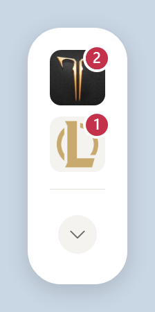
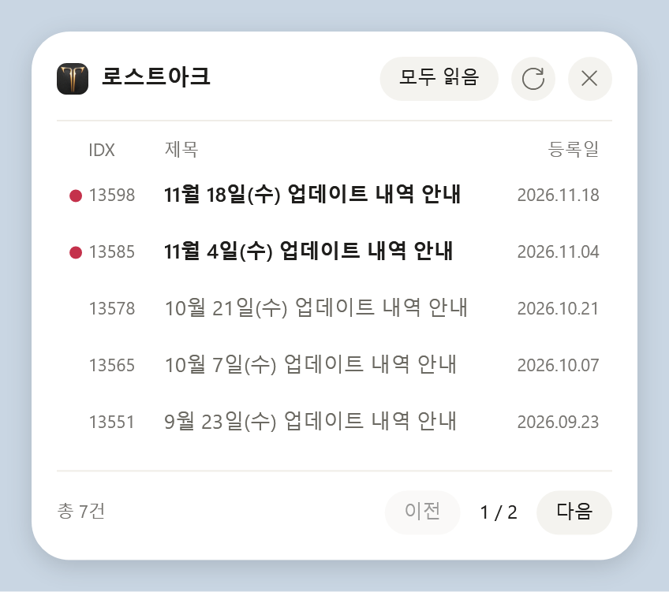
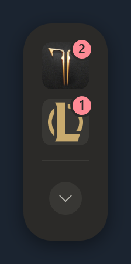
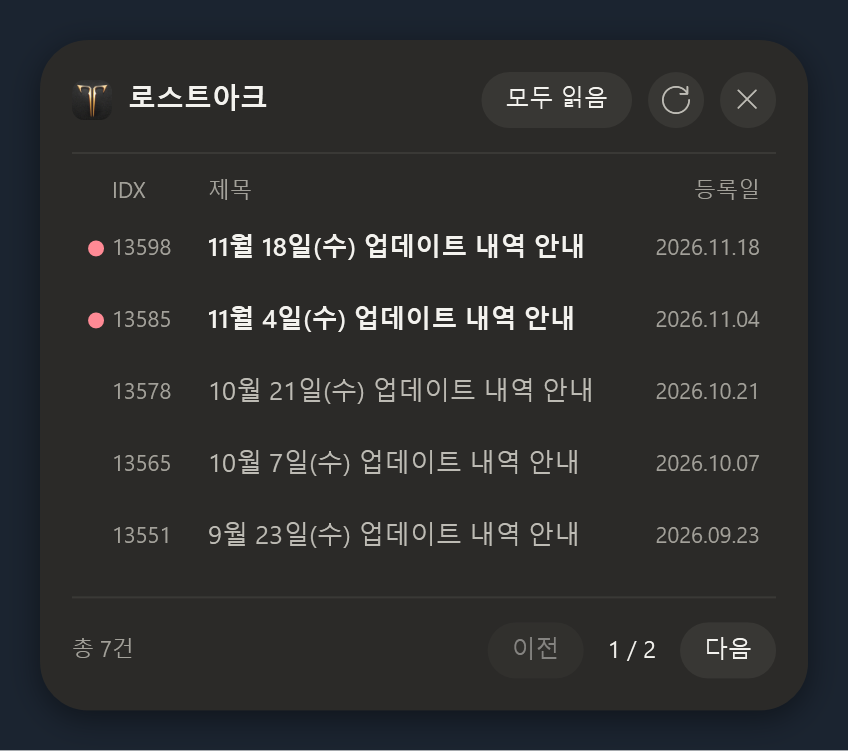

# Windows Game Patch Note Widget

A small, rounded desktop widget for Windows that acts as a **patch note mailbox** for your games — preconfigured for **Lost Ark** and **League of Legends**, with an extensible provider config for adding any other game.

Built on [BWUI](https://github.com/byeonggwan/bwui), a small design system for always-on Windows desktop widgets. BWUI provides the card, desktop pinning, placement, the right-click menu, light / dark / high contrast themes, settings and the snapshot renderer. It is vendored in `BWUI/` (version in `BWUI/VERSION`).

| | Expanded | Collapsed | Patch Note List |
|---|---|---|---|
| Light |  |  |  |
| Dark |  |  |  |

- Shows each game's **official icon** with an **unread count badge** on the top-right (`0` hides the badge).
- One click smoothly **collapses / expands** in your chosen direction (**Up / Down / Left / Right**) with the toggle button anchored in place; when collapsed, shows a single mailbox icon with the **total unread count** across all games.
- Clicking a game icon opens a clean **5-item paginated list** (`IDX`, title, date — latest first). Unread notes have a dot and a bold title. Clicking any row opens the patch note in your default browser and marks it as read.
- Checks a few seconds after launch and **every 1 hour** in the background (twice as long on battery), with manual refresh via right-click or the refresh button.
- Honest about its data: a loading placeholder before the first fetch, an error message with **Retry** when a fetch fails, and an "as of 5 h ago" caption when the cached list is old.
- Follows the Windows light / dark setting and High Contrast, or a theme you pick from the menu.
- Sits on the desktop behind your windows, hidden from the taskbar and Alt+Tab. Drag it anywhere; position, collapsed state and direction are remembered.
- Right-click: collapse/expand, expand direction (click to cycle Up → Right → Down → Left), open `games.json`, then refresh now, theme, start with Windows, exit.
- UI text follows the Windows display language (Korean or English).
- **No API keys, no installer, no runtime to download** — built with the C# compiler (`csc.exe`) that ships with Windows 10/11, using software-only WPF rendering to keep memory and CPU usage minimal.

## Requirements

- Windows 10 or 11 with .NET Framework 4.8 (preinstalled on current Windows 10/11)

## Install

```powershell
git clone https://github.com/byeonggwan/windows-game-patchnote-widget.git
cd windows-game-patchnote-widget
powershell -ExecutionPolicy Bypass -File .\build.ps1 -Install
Start-Process "$env:LOCALAPPDATA\PatchNoteMailbox\PatchNoteMailbox.exe"
```

`build.ps1` compiles BWUI and the widget into `bin\PatchNoteMailbox.exe`. `-Install` also stops a running copy and copies the exe to `%LOCALAPPDATA%\PatchNoteMailbox`; `-Snapshots` re-renders the images in `docs\`. Official game icons are fetched and cached locally at runtime; no game logos are bundled in the source.

To start the widget with Windows, right-click it and check **Windows 시작 시 실행** / **Start with Windows**, or run:

```powershell
Set-ItemProperty 'HKCU:\Software\Microsoft\Windows\CurrentVersion\Run' -Name PatchNoteMailbox -Value "`"$env:LOCALAPPDATA\PatchNoteMailbox\PatchNoteMailbox.exe`""
```

## How patch notes are fetched

No API keys or headless browsers are required. Every source runs through a single lightweight HTTP `GET` and a generalized provider adapter:

### Lost Ark (`html-regex`)

Fetches the official Korean Lost Ark notice list and filters strictly to posts containing **`업데이트 내역 안내`** in the title, extracting each post's numeric `idx`, title, date, and direct link.

### League of Legends (`next-data`)

Fetches the official Korean League of Legends patch notes page and parses the embedded `<script id="__NEXT_DATA__">` JSON (`props.pageProps.page.blades[type=articleCardGrid].items`), extracting the patch version (`idx`), title, publish date, and link.

### Adding other games (`games.json`)

Right-click the widget and select **games.json 열기** / **Open games.json** (or edit `%LOCALAPPDATA%\PatchNoteMailbox\games.json`). Four built-in provider adapters are supported:

| `provider.type` | Use case |
|---|---|
| `html-regex` | Server-rendered notice boards (named regex groups: `idx`, `title`, `date`, `url`) |
| `next-data` | Next.js pages with embedded `__NEXT_DATA__` JSON |
| `json-api` | Any REST JSON endpoint (with optional custom `headers` and dot-path `itemsPath`) |
| `rss` | Standard RSS 2.0 / Atom XML feeds |

Every provider also supports optional title filtering via `provider.filter.titleIncludes` and `provider.filter.titleRegex`. The widget polls at the shortest `pollIntervalMinutes` in the file, but never more often than every 5 minutes.

## Files

```
BWUI/                          Vendored BWUI design system (tokens, components, widget window, app host)
Program.cs                     Entry point: --test-fetch, then Bwui.App.Run (single instance, --snapshot)
Models/Models.cs               GameConfig, ProviderConfig, PatchNoteItem, AppState
Services/PatchNoteFetcher.cs   Generalized fetcher (html-regex, next-data, json-api, rss) + icon cache
Services/StorageService.cs     JSON persistence for games.json and state.json
UI/DockWindow.cs               The dock (a BwuiWindow): game tiles, unread badges, collapse/expand, 4 directions
UI/PopoverWindow.cs            5-item paginated patch note list with the BWUI card look
UI/UiExtras.cs                 Components built from BWUI tokens that BWUI doesn't have yet
build.ps1                      Build to bin\ (-Install, -Snapshots)
```

Data and settings live in `%LOCALAPPDATA%\PatchNoteMailbox`:

| File | Purpose |
|---|---|
| `settings.txt` | BWUI settings: window position (`left`, `top`) and `theme` |
| `games.json` | Registered games and provider configs |
| `data/state.json` | Cached patch notes, read IDs, last fetch time, collapsed state, expand direction |
| `data/icons/*.png` | Locally cached official game icons |

Updating from a version before BWUI keeps your widget where it was: on the first start, the old position in `state.json` is moved to `settings.txt`.

Preview without showing the window:

```powershell
& .\bin\PatchNoteMailbox.exe --snapshot preview.png dark popover   # [light|dark] [collapsed|popover]
```

## Uninstall

1. Right-click the widget and choose **종료** / **Exit**.
2. Remove the startup entry: `Remove-ItemProperty 'HKCU:\Software\Microsoft\Windows\CurrentVersion\Run' -Name PatchNoteMailbox`
3. Delete `%LOCALAPPDATA%\PatchNoteMailbox`.

## Limitations

- Windows only.
- Relies on the public HTML/JSON structure of each game's official patch note page. If a site changes its markup, update its selector/path in `games.json`.

## Disclaimer

This is an unofficial community project. It is not affiliated with or endorsed by Smilegate RPG or Riot Games. Lost Ark and League of Legends are trademarks of their respective owners.

## License

[MIT](LICENSE)
