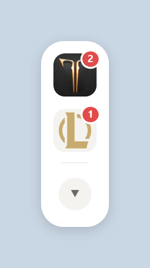
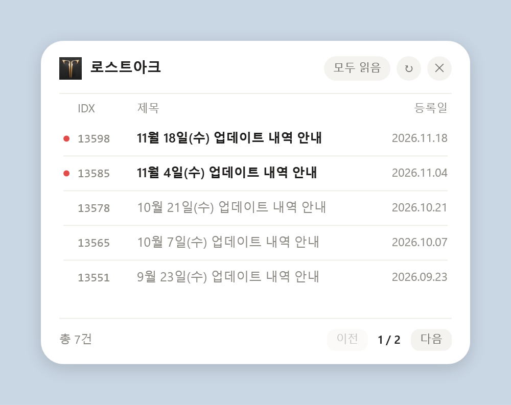

# Windows Game Patch Note Widget

A small, rounded desktop widget for Windows that acts as a **patch note mailbox** for your games — preconfigured for **Lost Ark** and **League of Legends**, with an extensible provider config for adding any other game.

| Expanded | Collapsed | Patch Note List |
|---|---|---|
|  |  |  |

- Shows each game's **official icon** with an **unread count badge** on the top-right (`0` hides the badge).
- One click smoothly **collapses downward / expands upward** with the bottom toggle button anchored in place; when collapsed, shows a single mailbox icon with the **total unread count** across all games.
- Clicking a game icon opens a clean **5-item paginated list** (`IDX`, title, date — latest first). Clicking any row opens the patch note in your default browser and marks it as read.
- Checks automatically on launch and **every 1 hour** in the background (with manual refresh via right-click or the `↻` button).
- Sits on the desktop behind your windows, hidden from the taskbar and Alt+Tab. Drag it anywhere; position and collapsed state are remembered.
- Right-click: refresh now, collapse/expand, switch vertical/horizontal layout, start with Windows, open `games.json`, quit.
- **No API keys, no installer, no runtime to download** — built with the C# compiler (`csc.exe`) that ships with Windows 10/11, using software-only WPF rendering to keep memory and CPU usage minimal.

> The widget's UI labels are in Korean (`제목` = title, `등록일` = date, `모두 읽음` = mark all read).

## Requirements

- Windows 10 or 11 with .NET Framework 4.x (preinstalled on Windows 10/11)

## Install

```powershell
git clone https://github.com/byeonggwan/windows-game-patchnote-widget.git
cd windows-game-patchnote-widget
powershell -ExecutionPolicy Bypass -File .\build.ps1
Start-Process "$env:LOCALAPPDATA\PatchNoteMailbox\PatchNoteMailbox.exe"
```

`build.ps1` compiles `PatchNoteMailbox.exe` and installs it to `%LOCALAPPDATA%\PatchNoteMailbox`. Official game icons are fetched and cached locally at runtime; no game logos are bundled in the source.

To start the widget with Windows, right-click it and check **Windows 시작 시 실행** (start with Windows), or run:

```powershell
Set-ItemProperty 'HKCU:\Software\Microsoft\Windows\CurrentVersion\Run' -Name PatchNoteMailbox -Value "`"$env:LOCALAPPDATA\PatchNoteMailbox\PatchNoteMailbox.exe`""
```

## How patch notes are fetched

No API keys or headless browsers are required. Every source runs through a single lightweight HTTP `GET` and a generalized provider adapter:

### Lost Ark (`html-regex`)

Fetches the official Korean Lost Ark notice list and filters strictly to posts containing **`업데이트 내역 안내`** in the title, extracting each post's numeric `idx`, title, date, and direct link.

### League of Legends (`next-data`)

Fetches the official Korean League of Legends patch notes page and parses the embedded `<script id="__NEXT_DATA__">` JSON (`props.pageProps.page.blades[type=articleCardGrid].items`), extracting the patch version (`idx`), title, publish date, and link.

### Adding other games (`games.json`)

Right-click the widget and select **games.json 열기** (or edit `%LOCALAPPDATA%\PatchNoteMailbox\games.json`). Four built-in provider adapters are supported:

| `provider.type` | Use case |
|---|---|
| `html-regex` | Server-rendered notice boards (named regex groups: `idx`, `title`, `date`, `url`) |
| `next-data` | Next.js pages with embedded `__NEXT_DATA__` JSON |
| `json-api` | Any REST JSON endpoint (with optional custom `headers` and dot-path `itemsPath`) |
| `rss` | Standard RSS 2.0 / Atom XML feeds |

Every provider also supports optional title filtering via `provider.filter.titleIncludes` and `provider.filter.titleRegex`.

## Files

```
Program.cs                     Entry point, single-instance mutex, CLI flags (--snapshot, --test-fetch)
Models/Models.cs               GameConfig, ProviderConfig, PatchNoteItem, AppState
Services/PatchNoteFetcher.cs   Generalized fetcher (html-regex, next-data, json-api, rss) + icon cache
Services/StorageService.cs     JSON persistence for games.json and state.json
UI/DockWindow.cs               Desktop-pinned floating dock with smooth collapse/expand animation
UI/PopoverWindow.cs            5-item paginated patch note list popover
build.ps1                      Build and install to %LOCALAPPDATA%\PatchNoteMailbox
```

Data and settings live in `%LOCALAPPDATA%\PatchNoteMailbox`:

| File | Purpose |
|---|---|
| `games.json` | Registered games and provider configs |
| `data/state.json` | Cached patch notes, read IDs, dock position, layout, collapsed state |
| `data/icons/*.png` | Locally cached official game icons |

Preview without showing the window:

```powershell
& "$env:LOCALAPPDATA\PatchNoteMailbox\PatchNoteMailbox.exe" --snapshot preview.png expanded   # or collapsed / popover
```

## Uninstall

1. Right-click the widget and choose **종료** (quit).
2. Remove the startup entry: `Remove-ItemProperty 'HKCU:\Software\Microsoft\Windows\CurrentVersion\Run' -Name PatchNoteMailbox`
3. Delete `%LOCALAPPDATA%\PatchNoteMailbox`.

## Limitations

- Windows only.
- Relies on the public HTML/JSON structure of each game's official patch note page. If a site changes its markup, update its selector/path in `games.json`.

## Disclaimer

This is an unofficial community project. It is not affiliated with or endorsed by Smilegate RPG or Riot Games. Lost Ark and League of Legends are trademarks of their respective owners.

## License

[MIT](LICENSE)
